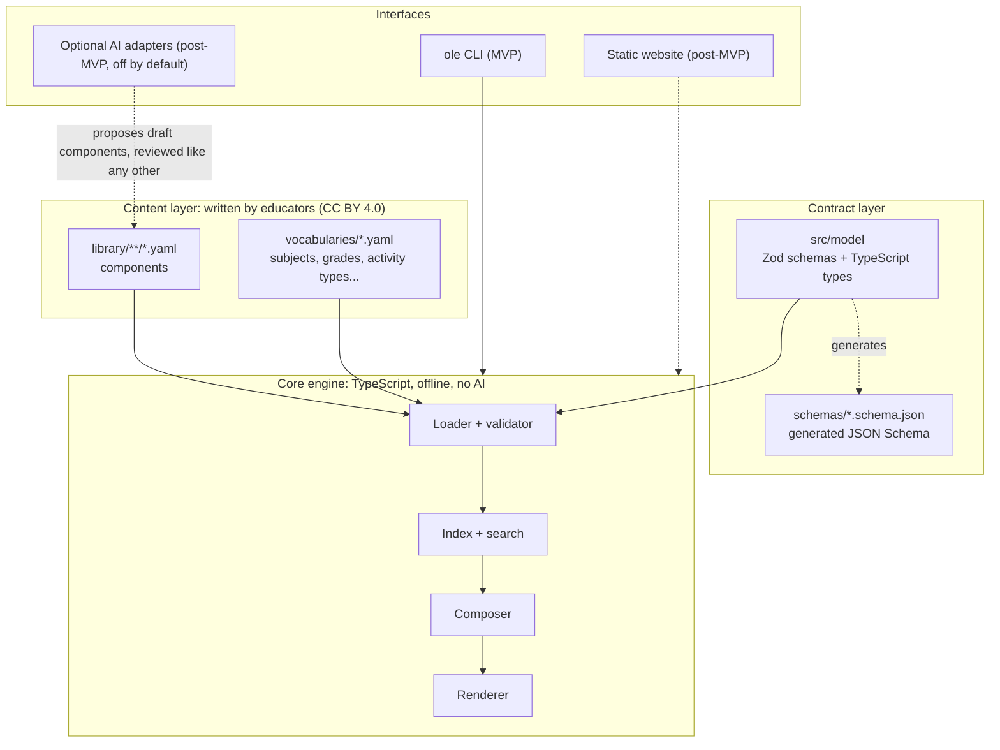
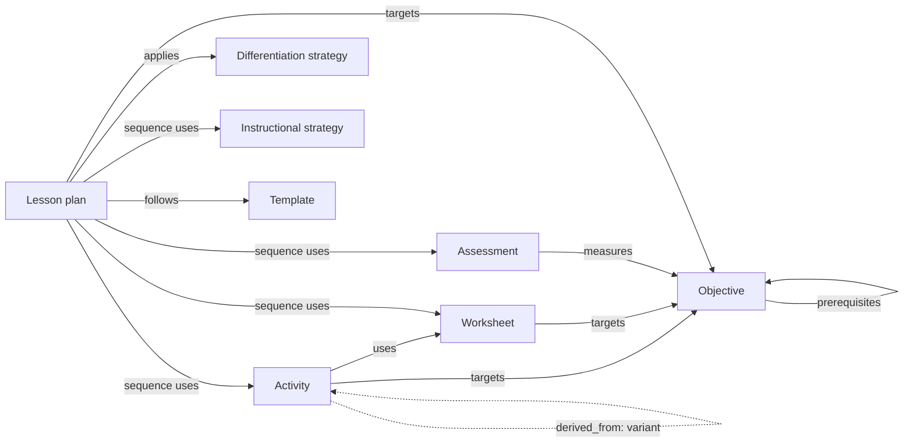

# Development Guide

This document describes the architecture, domain model, and development philosophy of Open Lesson Engine. It is written for two audiences at once: **developers** who will build the engine, and **educators** who want to understand how their contributions are represented.

> **Status: foundation stage.** No application code exists yet. Everything below describes the *intended* design. It will be updated as the [first ten implementation tasks](docs/roadmap/mvp-tasks.md) land. Major decisions are recorded as [Architecture Decision Records](docs/decisions/) so they can be challenged and revised in the open.

## Contents

1. [Where the project stands](#1-where-the-project-stands)
2. [Philosophy](#2-philosophy)
3. [Architecture](#3-architecture)
4. [Technology stack](#4-technology-stack)
5. [Domain model](#5-domain-model)
6. [How components are represented](#6-how-components-are-represented)
7. [How components compose into lessons](#7-how-components-compose-into-lessons)
8. [Adaptation and differentiation](#8-adaptation-and-differentiation)
9. [Validation](#9-validation)
10. [Privacy by design](#10-privacy-by-design)
11. [Extensibility](#11-extensibility)
12. [The MVP](#12-the-mvp)
13. [What the MVP will not include](#13-what-the-mvp-will-not-include)
14. [Repository structure](#14-repository-structure)
15. [Decision records](#15-decision-records)
16. [Glossary for developers](#16-glossary-for-developers)
17. [Development workflow](#17-development-workflow)

---

## 1. Where the project stands

As of September 2026 the repository contains:

| File | Purpose |
| --- | --- |
| `README.md` | Project vision, audience, principles, roadmap |
| `DEVELOPMENT.md` | This document: architecture and philosophy |
| `CONTRIBUTING.md` | How educators and developers contribute |
| `CODE_OF_CONDUCT.md` | Contributor Covenant 3.0 with project-specific expectations |
| `LICENSE` | MIT License (software) |
| `LICENSE-CONTENT` | CC BY 4.0 (educational content in `library/`) |
| `docs/decisions/` | Architecture Decision Records (ADRs) |
| `docs/roadmap/mvp-tasks.md` | The first ten implementation tasks, written as GitHub issues |

There is no application code, schema, or content library yet. That is intentional. This stage sets the foundation so that code and contributions have a shared, documented target.

---

## 2. Philosophy

Open Lesson Engine is **a structured educational component framework**, not an AI lesson-plan generator. Teachers contribute small, reusable, well-described pieces: objectives, activities, worksheets, assessments, strategies, and templates. The engine validates those pieces, helps people find them, and assembles them into complete lessons.

Each project principle translates into concrete engineering rules:

| Principle | What it means for the code |
| --- | --- |
| **1. Teachers are the subject-matter experts** | Tools *propose*; teachers *decide*. Nothing is marked reviewed or classroom-tested without a human. Every composed lesson is an editable draft, and the composer explains why it chose each piece. |
| **2. AI is optional infrastructure** | The core engine has no AI dependencies and makes no network calls. If AI is added later, it plugs in through an adapter interface, stays off by default, and its output goes through the same validation and human review as anyone else's contribution. |
| **3. Components are reusable and composable** | Components are small and single-purpose. They reference each other by ID. Lessons are assembled from references rather than copied-and-pasted text. |
| **4. Community contributions are first-class** | Contributions go directly into the library; there is no second-class "contributions" staging area. The file format is designed to be written by hand, and error messages are written for teachers, not programmers. |
| **5. Resources are adaptable** | Any component can be adapted into a **variant** that records where it came from and credits the original contributors. Only licenses that allow adaptation are accepted. |
| **6. Useful without an AI API** | The MVP contains no AI at all. Search, validation, composition, and rendering are deterministic and work offline. |
| **7. No personally identifiable student information** | The model has no `Student` entity. There are no rosters, IEP data, grades, or student work. Learner-need categories describe *materials*, never people. |
| **8. Simple and extensible** | Plain files in git rather than a database and server. One package rather than many. Controlled vocabularies are data, so they can grow without code changes. New fields are added as optional so existing files keep working. |

### Engineering rules of thumb

- **Prefer boring technology.** Every dependency has to earn its place.
- **Pure core, I/O at the edges.** Only the loader and CLI touch the filesystem. Everything else is plain functions over plain data, which keeps it testable and able to run in a browser later.
- **Deterministic by default.** The same library and the same request always produce the same output.
- **Errors a teacher can act on.** Every message names the file, the line, what's wrong, and how to fix it.
- **Documentation is part of the change.** A pull request that changes behavior updates the docs.
- **Big decisions get an ADR.** If you're changing something another contributor would reasonably want a say in, write it down in `docs/decisions/` first.

---

## 3. Architecture

**Content-as-code.** The component library is a folder of plain-text YAML files in git. A small TypeScript engine reads, validates, indexes, composes, and renders those files. User-facing interfaces sit on top of the engine: first a command-line tool, later a static website.



### Layers

1. **Content layer (`library/`, `vocabularies/`).** The source of truth. Each component is one YAML file. Git provides version history, attribution (every change has an author), review (pull requests), adaptation (forks and variants), free hosting, and offline copies without the project building any of it.
2. **Contract layer (`src/model/`, `schemas/`).** Defines what a valid component is. Schemas are written in TypeScript with [Zod](https://zod.dev) and exported to [JSON Schema](https://json-schema.org). The exported schemas give editors such as VS Code autocomplete and inline errors while someone writes a YAML file. They also let tools in other languages validate the same files.
3. **Core engine (`src/library/`, `src/compose/`, `src/render/`).** Pure functions that load, validate, index, resolve references, compose, and render. It avoids Node-only APIs outside the loader so the same engine can later run in a web browser.
4. **Interfaces (`src/cli/`, later a static site).** Thin layers over the engine. The CLI comes first because it is the smallest useful interface and it powers automated checks on contributions.

### Why files in git instead of a web app with a database?

A database-backed web app needs hosting, accounts, moderation tools, backups, and ongoing money. The project philosophy says not to build those first. Files in git give the essential features (versioning, review, attribution, adaptation) at no cost. Schools and districts can also download the whole library and use it offline.

**Trade-off:** GitHub is a barrier for many teachers. The project reduces that barrier with issue forms that need no git knowledge, GitHub's in-browser file editor, a step-by-step educator guide, and later a static website with "suggest a component" links. **Revisit this decision** if contribution volume or a real feature need outgrows files. See [ADR 0001](docs/decisions/0001-content-as-code.md).

### Example data flow

```text
ole render photosynthesis-leaf-disk-lesson
  → load every file in library/ and vocabularies/
  → validate them (schema, vocabulary, cross-references)
  → resolve the lesson's references to activities, worksheets, assessments
  → render: teacher copy, student handouts, answer keys, attribution
```

---

## 4. Technology stack

| Concern | Choice | Why |
| --- | --- | --- |
| Language | **TypeScript** (strict mode) | One language covers validation, CLI, and a future browser-based site. Types document the domain model for contributors. |
| Runtime | **Node.js 22 LTS or later** | Long-term support, installed on most developer machines, and it includes npm. |
| Content format | **YAML 1.2** files; **Markdown** inside long text fields | Readable and writable by non-programmers. Allows comments. Produces clean diffs in pull requests. |
| Schemas | **Zod 4** as the source; **JSON Schema** generated from it | Zod is readable TypeScript that gives both runtime validation and static types. JSON Schema gives editor autocomplete and a language-neutral contract. |
| YAML parsing | [`yaml`](https://eemeli.org/yaml/) | Reports line and column numbers for teacher-friendly errors. Uses YAML 1.2, so `no` and `off` stay strings rather than turning into `false`. |
| Tests | **Vitest** | Fast and built for TypeScript with little configuration. |
| Lint and format | **Biome** | One fast tool instead of ESLint plus Prettier, with one config file. |
| CLI arguments | Node's built-in `util.parseArgs` | No framework dependency is needed for a handful of commands. |
| Markdown → HTML | `markdown-it` (task 9) | Mature and extensible, and output can be sanitized. |
| Package manager | **npm** | Ships with Node, so there is nothing extra to install. |
| CI | **GitHub Actions** | Free for public repositories and already where the project lives. |
| Storage | **Git** (no database) | See [ADR 0001](docs/decisions/0001-content-as-code.md). |
| Hosting (post-MVP) | **GitHub Pages** static site | Free, with no servers to maintain. |

### Alternatives considered

- **Python with Pydantic.** An excellent choice, and friendlier to educators who script a little. It was rejected because a future web interface would then need a second language. TypeScript runs the same validation and composition code in the CLI and in the browser, so the static site can compose lessons *on the teacher's own device* with no server. Because the real contract is the YAML format plus the generated JSON Schema, a Python toolkit can still be built against it later.
- **Hand-written JSON Schema as the source.** It is language-neutral but verbose and hard for new contributors to read or change. Generating it from Zod keeps one readable source.
- **Markdown files with YAML front matter.** Very teacher-friendly for prose, but awkward for structured parts such as worksheet questions, rubrics, and lesson sequences. The project uses a single format (YAML) and allows Markdown *inside* long text fields.
- **SQLite or another database.** It isn't needed at MVP scale. A generated `catalog.json` index serves search and a future website.

See [ADR 0002](docs/decisions/0002-typescript-zod-json-schema.md).

---

## 5. Domain model

### 5.1 Overview

Everything in the library is a **component**. All components share a common foundation of identity, classification, and provenance. Each **component type** then adds its own fields. Components refer to each other by ID.



Any component can be `derived_from` another component of the same type. The dotted edge above shows it for activities, but it applies to every type.

### 5.2 Component types

| Type (`type:`) | Folder | What it is | Examples |
| --- | --- | --- | --- |
| `objective` | `library/objectives/` | A curriculum objective: one thing students should know or be able to do, with student-friendly success criteria | "Identify the inputs and outputs of photosynthesis" |
| `activity` | `library/activities/` | Something students do, with materials, steps, timing, and safety notes | A leaf-disk lab; a soil-texture jar test; a vocabulary sort |
| `worksheet` | `library/worksheets/` | A student handout with structured items and an answer key | Labeled diagram of the water cycle; a data table |
| `assessment` | `library/assessments/` | A way of checking learning: items, a rubric, or a skills checklist | Exit ticket; quiz; greenhouse transplanting skills check |
| `differentiation_strategy` | `library/differentiation/` | A reusable way to adapt materials for a category of learner need | Word bank; chunked directions; picture cues; extension challenge |
| `instructional_strategy` | `library/instructional-strategies/` | A reusable teaching move or routine | Think-pair-share; gradual release (I do / we do / you do); jigsaw |
| `template` | `library/templates/` | A lesson *structure*: ordered slots with constraints that lessons can follow | 5E model; direct instruction; work-based skills lesson |
| `lesson_plan` | `library/lesson-plans/` | A complete lesson composed of a sequence of segments, most of which reference other components | "Where does a plant's oxygen come from?" (90-minute block) |

Units and courses (sequences of lessons) are a natural next composition level. They are deferred beyond the MVP (see §13).

### 5.3 The common foundation (all components)

The foundation is **deliberately small**. Only the identity and sharing fields are required everywhere. Classification fields are optional unless a component type requires them. For example, `duration_minutes` is required for activities and lesson plans, but it doesn't apply to objectives, differentiation strategies, or templates.

| Field | Required | Description |
| --- | --- | --- |
| `id` | ✅ | Stable, unique, kebab-case identifier, e.g. `floating-leaf-disks`. Must match the file name. |
| `type` | ✅ | One of the component types in §5.2. |
| `version` | ✅ | Version of *this component's content*, e.g. `1.0.0` (see §6.5). |
| `title` | ✅ | Short human-readable name. |
| `summary` | ✅ | One to three sentences written for another teacher. |
| `license` | ✅ | `CC-BY-4.0` (default), `CC-BY-SA-4.0`, or `CC0-1.0` ([ADR 0003](docs/decisions/0003-licensing.md)). |
| `contributors` | ✅ | People credited for the work: `name` (as they wish to be credited, pseudonyms welcome), `role` (`author`, `adapter`, `reviewer`, `classroom_tester`, `translator`), and an optional `url`. No email addresses. |
| `status` | ✅ | `draft`, `reviewed`, or `classroom_tested` (see [CONTRIBUTING.md](CONTRIBUTING.md#component-status)). |
| `description` | | Longer Markdown description. |
| `subjects` | | Subject IDs from the subjects vocabulary, e.g. `[biology]`. |
| `topics` | | Free-text topics, e.g. `[photosynthesis]`. |
| `grades` | | A grade range: `7`, `6-8`, `K-2`, `9-12` (see §5.4). |
| `duration_minutes` | | Estimated time in minutes. |
| `difficulty` | | `foundational`, `standard`, or `advanced`, relative to the grade range. |
| `standards` | | Standards references, e.g. `NGSS:MS-LS1-6` (see §5.4). |
| `objectives` | | IDs of `objective` components this component targets. |
| `prerequisites` | | IDs of `objective` components students should have met first. |
| `prior_knowledge` | | Free-text prerequisites when no objective component exists yet. |
| `tags` | | Free-form keywords for search. |
| `language` | | Language of the content ([BCP 47](https://www.rfc-editor.org/info/bcp47)); defaults to `en`. |
| `derived_from` | | `{ id, version }` of the component this one adapts (see §8). |
| `adaptation` | | What this variant changes and for whom (see §8). |
| `sources` | | External works this builds on: `{ title, url, license }`. |
| `ai_assisted` | | `true` if AI tools helped draft the content. Transparency only; the content is still reviewed by educators. |
| `created`, `updated` | | ISO dates (`2026-09-28`). Optional because git records history; the index derives them from git when missing. |
| `schema_version` | | Version of the file format. Defaults to `1`; only needed after a breaking format change (see §11). |

**Naming conventions:** field names and vocabulary IDs use `snake_case` (matching `activity_type: hands_on`). Component IDs and folder names use `kebab-case` because they become file names and URLs.

### 5.4 Shared value types

These structured types are defined once and reused across component types.

**Grade range.** Written as a single grade (`7`) or a range (`6-8`, `K-2`, `9-12`). It is parsed into `{ min, max }` using the ordered grade-level vocabulary: `PK`, `K`, `1` … `12`, `transition` (post-secondary transition programs for ages 18–21, common in special education), and `adult`. Ranges are compared by overlap. A component for `6-8` matches a request for grade `7`.

**Standards reference.** Written as `FRAMEWORK:CODE`, e.g. `NGSS:MS-LS1-6` or `CCSS-ELA:RST.6-8.3`. The separator is a colon rather than a dot because many standards codes already contain dots. The framework must exist in the standards-frameworks vocabulary, which may also define a pattern to check codes against. The library stores **references only**, not the text of the standards: standards text carries its own copyright and maintenance burden. It is parsed into `{ framework, code }`.

**Duration.** A whole number of minutes (`duration_minutes: 45`). The unit is part of the field name to avoid ambiguity between minutes, class periods, and days.

**Difficulty.** `foundational` | `standard` | `advanced`, always *relative to the grade range*.

> **Grade, difficulty, and reading level are separate on purpose.** In special education and intervention settings, a 10th-grade biology worksheet may cover on-grade content written at a 4th-grade reading level. So the model keeps three independent fields:
> - `grades`: who the material is *for*
> - `difficulty`: the conceptual demand, relative to those grades
> - `reading_level` (on text-heavy types): approximate readability of the text, as a grade number
>
> Built-in scaffolds are described separately by the `adaptation` block (§8).

**Reference.** A component ID string, such as `floating-leaf-disks`. The validator checks that it resolves and that the target has the right type. For example, `objectives:` may only reference `objective` components. References are not version-pinned in the MVP because the git commit pins the whole library.

**Item** (shared by worksheets and assessments). A structured question or task with:

- `kind`: `multiple_choice`, `true_false`, `short_answer`, `fill_in_blank`, `matching`, `ordering`, `labeling`, `drawing`, `data_table`, `extended_response`
- `prompt`
- `choices`, where relevant
- `answer`: kept in the file and removed from student copies at render time
- `points`, `hint`, and `objective` (all optional)

**Material.** `{ item, quantity?, notes? }`.

**Step.** `{ minutes?, teacher, student? }`: the teacher-facing instruction and optional student-facing wording.

### 5.5 Controlled vocabularies

Vocabularies keep metadata consistent so search and composition work. There are two kinds.

**Open vocabularies are data.** They live in `vocabularies/*.yaml`, and anyone can propose a new term with a pull request. No code changes are needed.

| Vocabulary | Used by | Starter terms (illustrative) |
| --- | --- | --- |
| `subjects` | `subjects` | Hierarchical: `science` → `life_science` → `biology`; `science` → `earth_space_science`; `science` → `environmental_science`; `career_technical_education` → `agriculture` → `horticulture`; `mathematics`; `english_language_arts`; `social_studies`; … |
| `grade_levels` | `grades` | `PK`, `K`, `1`–`12`, `transition`, `adult` (ordered) |
| `activity_types` | `activity_type` | `hands_on`, `lab_investigation`, `demonstration`, `discussion`, `direct_instruction`, `reading`, `writing`, `vocabulary`, `modeling`, `simulation`, `game`, `project`, `field_observation`, `skills_practice`, `review` |
| `instructional_formats` | `formats` | `whole_class`, `small_group`, `partner`, `independent`, `one_on_one`, `stations`, `lab`, `field_work`, `work_based`, `remote` |
| `learner_needs` | `adaptation.learner_needs`, strategies | `reading`, `writing`, `math`, `language` (multilingual learners), `executive_function`, `processing_time`, `memory`, `fine_motor`, `mobility`, `vision`, `hearing`, `sensory`, `social_communication`, `self_regulation`, `enrichment` |
| `standards_frameworks` | `standards` | `NGSS`, `CCSS-ELA`, `CCSS-MATH`, `AFNR` (agriculture, food and natural resources), `LOCAL` (district or state standards not yet listed) |

A vocabulary file looks like this:

```yaml
# vocabularies/activity-types.yaml
vocabulary: activity_types
description: What students are mainly doing during an activity.
terms:
  - id: hands_on
    label: Hands-on
    description: Students manipulate materials, specimens, or tools.
  - id: skills_practice
    label: Skills practice
    description: Students practice a procedural or vocational skill (e.g. transplanting, measuring, pipetting).
```

Learner needs are **functional needs, not diagnoses or disability labels.** A term like `executive_function` says what kind of support a material provides. It never says anything about a particular student (see §10).

**Closed enumerations are code.** These are values that engine logic depends on. Changing them requires a code change and review: component `type`, `status`, `license`, `difficulty`, `cognitive_level` (revised Bloom's taxonomy: `remember`, `understand`, `apply`, `analyze`, `evaluate`, `create`), assessment `purpose` (`diagnostic`, `formative`, `summative`), `adaptation.kind`, item `kind`, and contributor `role`.

### 5.6 Type-specific fields (summary)

These are outlines. The full field lists are specified in [tasks 3–4](docs/roadmap/mvp-tasks.md).

| Type | Required beyond the foundation | Notable optional fields |
| --- | --- | --- |
| `objective` | `statement` | `cognitive_level`, `success_criteria` ("I can…" statements), `vocabulary`, `grades`, `standards`, `prerequisites` |
| `activity` | `activity_type`, `duration_minutes`, `steps` | `formats`, `materials`, `preparation`, `safety`, `worksheets` (refs), `objectives`, `resources` (external links) |
| `worksheet` | `items` or `sections` | `instructions`, `word_bank`, `reading_level`, `objectives` |
| `assessment` | `purpose`, and one of `items`, `rubric`, or `checklist` | `format` (`exit_ticket`, `quiz`, `test`, `performance_task`, `skills_check`, `observation`), `duration_minutes`, `objectives`, `scoring_notes` |
| `differentiation_strategy` | `kind` (`accommodation`, `modification`, `extension`), `learner_needs`, `how_to` | `applies_to` (component types), `when_to_use`, `cautions`, `udl_principle` (`engagement`, `representation`, `action_expression`) |
| `instructional_strategy` | `how_to` | `formats`, `typical_minutes`, `best_for`, `learner_needs` |
| `template` | `slots` | `based_on` (e.g. "5E Instructional Model"), `typical_minutes` |
| `lesson_plan` | `duration_minutes`, `objectives`, `sequence` | `template`, `materials` (added to those gathered from components), `differentiation`, `vocabulary`, `teacher_notes` |

---

## 6. How components are represented

### 6.1 One component, one file

Each component is a single YAML file at `library/<type-folder>/<id>.yaml`. Long text fields can use Markdown. Comments (`# …`) are allowed and encouraged for notes to future editors.

### 6.2 From a teacher's notes to a component

A teacher might describe an activity like this:

```yaml
topic: Photosynthesis
grade: 7
duration: 45
difficulty: standard
activity_type: hands_on
standards:
  - NGSS.MS-LS1-6
```

That maps almost one-to-one onto the component format. The comments show each change:

```yaml
# library/activities/floating-leaf-disks.yaml
id: floating-leaf-disks
type: activity
version: 1.0.0
title: Floating leaf disks
summary: >
  Small groups watch spinach leaf disks float up in baking-soda water under a
  lamp, which is visible evidence that photosynthesis produces oxygen.

topics: [photosynthesis]     # "topic"    → a list, because activities often span topics
grades: 7                    # "grade"    → "grades", which also accepts ranges like 6-8
duration_minutes: 45         # "duration" → unit in the name
difficulty: standard
activity_type: hands_on
standards:
  - NGSS:MS-LS1-6            # colon separator, because many codes contain dots

subjects: [life_science]
formats: [small_group]
objectives: [photosynthesis-inputs-outputs]   # reference to an objective component

materials:
  - item: Fresh spinach leaves
  - item: Baking soda solution (about 1/8 teaspoon per 300 mL of water, plus one drop of dish soap)
  - item: Plastic syringe (10 mL, no needle)
    quantity: 1 per group
  - item: Clear cup and desk lamp
    quantity: 1 per group

steps:
  - minutes: 5
    teacher: >
      Demonstrate punching 10 disks from a leaf with a straw and pulling the
      air out of them with the syringe so they sink.
  - minutes: 5
    teacher: Groups prepare their own disks. Check that every group's disks sink.
  - minutes: 25
    teacher: >
      Place the cups under the lamps. Groups record how many disks are
      floating every 2 minutes in their data table.
    student: Every 2 minutes, count the floating disks and write the number in your table.
  - minutes: 10
    teacher: "Discuss: What gas filled the disks? Where did it come from?"

safety:
  - Keep lamp cords away from the water.
  - No food or drink near lab materials.

license: CC-BY-4.0
contributors:
  - name: Sample Contributor
    role: author
status: draft
```

The objective it references is its own small component:

```yaml
# library/objectives/photosynthesis-inputs-outputs.yaml
id: photosynthesis-inputs-outputs
type: objective
version: 1.0.0
title: Inputs and outputs of photosynthesis
summary: Name what a plant takes in and what it gives off during photosynthesis.
statement: >
  Students will identify the inputs of photosynthesis (light energy, water,
  carbon dioxide) and its outputs (glucose and oxygen).
cognitive_level: understand
success_criteria:
  - I can name the three things a plant needs to make its own food.
  - I can name the two things a plant makes during photosynthesis.
vocabulary: [photosynthesis, chlorophyll, carbon dioxide, glucose]
subjects: [life_science]
topics: [photosynthesis]
grades: 6-8
standards: [NGSS:MS-LS1-6]
license: CC-BY-4.0
contributors:
  - name: Sample Contributor
    role: author
status: draft
```

All names and content in these examples are fictional.

### 6.3 Identifiers and references

- IDs are **global** across the library (not per type), so a reference is just the ID: `use: floating-leaf-disks`.
- IDs are **stable**. Renaming one is a breaking change for every component that references it. The validator reports broken references immediately.
- The validator checks that the file path matches both `type` and `id`: `library/activities/floating-leaf-disks.yaml` must contain `type: activity` and `id: floating-leaf-disks`.

### 6.4 Licensing per component

Every component carries its `license`. The default is `CC-BY-4.0`. `CC-BY-SA-4.0` and `CC0-1.0` are also accepted, and all three can be combined in one composed lesson. The renderer works out the license of a composed lesson and prints an attribution block that lists every component and its contributors. See [ADR 0003](docs/decisions/0003-licensing.md).

### 6.5 Versioning

Each component has a `version` of the form `MAJOR.MINOR.PATCH`, explained for teachers like this:

| Change | Example | Bump |
| --- | --- | --- |
| Fix a typo or wording | "photosythesis" → "photosynthesis" | `1.0.0` → `1.0.1` |
| Improve without changing how it's used | Add a safety note or a better example | `1.0.0` → `1.1.0` |
| Change it enough that lessons using it should be rechecked | Remove a question, change the timing, change the objective | `1.0.0` → `2.0.0` |

`schema_version` is separate. It tracks the file *format*, not the content (see §11).

### 6.6 Editor support

Generated JSON Schemas in `schemas/` are mapped to library folders in the workspace editor settings. In VS Code with the YAML extension, contributors then get field autocomplete, inline documentation, and red squiggles for mistakes before they ever open a pull request ([task 4](docs/roadmap/mvp-tasks.md)).

---

## 7. How components compose into lessons

### 7.1 A lesson plan is a composition

A `lesson_plan` is a component whose `sequence` is an ordered list of **segments**. A segment either **uses** another component by reference, or contains **inline** teacher-written notes, or both. Inline notes allow a quick bespoke hook or a local instruction without forcing everything to become a separate component.

```yaml
# library/lesson-plans/photosynthesis-leaf-disk-lesson.yaml
id: photosynthesis-leaf-disk-lesson
type: lesson_plan
version: 1.0.0
title: Where does a plant's oxygen come from?
summary: A 5E block lesson built around the floating leaf disk lab.
template: five-e-lesson
subjects: [life_science]
topics: [photosynthesis]
grades: 7
duration_minutes: 90
objectives: [photosynthesis-inputs-outputs]

sequence:
  - slot: engage
    minutes: 5
    notes: >
      Show two photos of the same kind of plant, one grown by a window and one
      grown in a closet. Ask: "What is different, and why?"
  - slot: explore
    use: floating-leaf-disks
    minutes: 45
  - slot: explain
    use: photosynthesis-equation          # a worksheet
    minutes: 15
  - slot: elaborate
    use: think-pair-share                 # an instructional strategy
    minutes: 15
    notes: "Prompt: Would the disks float in a dark closet? Why or why not?"
  - slot: evaluate
    use: photosynthesis-exit-ticket       # an assessment
    minutes: 10

differentiation:
  - strategy: chunked-directions
    applies_to: [floating-leaf-disks]
    notes: Hand each group one step card at a time.

license: CC-BY-4.0
contributors:
  - name: Sample Contributor
    role: author
status: draft
```

When rendered, the lesson brings its pieces together. The renderer lists materials from every referenced component, shows the timing table and each segment's full instructions, and outputs worksheets as separate student handouts with answer keys removed. It also produces a separate answer key and an attribution block. **Variants are found automatically.** If `photosynthesis-equation-supported` is `derived_from` `photosynthesis-equation`, the teacher copy lists it as an available alternative without the lesson having to mention it.

### 7.2 Templates describe lesson structure

A `template` is an ordered list of **slots**. Each slot has a purpose and optional constraints. Templates hold teaching expertise about *how lessons are shaped*, separately from their content, so that expertise is reusable too.

```yaml
# library/templates/work-based-skills-lesson.yaml
id: work-based-skills-lesson
type: template
version: 1.0.0
title: Work-based skills lesson
summary: >
  A structure for hands-on vocational lessons (greenhouse, shop, kitchen):
  safety first, then demonstrate, practice, clean up, and reflect.
subjects: [career_technical_education]
slots:
  - key: safety_briefing
    label: Safety briefing
    purpose: Review the tools, hazards, and protective equipment for today's task.
    accepts: [activity, instructional_strategy]
    minutes: { min: 5, max: 10 }
    required: true
  - key: demonstration
    label: Teacher demonstration
    accepts: [activity]
    activity_types: [demonstration]
    minutes: { min: 5, max: 15 }
    required: true
  - key: guided_practice
    label: Guided practice
    accepts: [activity]
    activity_types: [hands_on, skills_practice]
    minutes: { min: 15, max: 40 }
    required: true
  - key: cleanup
    label: Cleanup and tool check
    accepts: [activity]
    minutes: { min: 5, max: 10 }
    required: true
  - key: skills_check
    label: Skills check
    accepts: [assessment]
    required: false
license: CC-BY-4.0
contributors:
  - name: Sample Contributor
    role: author
status: draft
```

Any slot can be filled with inline notes instead of a component.

### 7.3 Three levels of composition

| Level | How it works | When |
| --- | --- | --- |
| **1. Hand-composed** | A teacher writes a `lesson_plan` that references components. The engine validates it and renders it. | MVP ([task 9](docs/roadmap/mvp-tasks.md)) |
| **2. Rule-assisted** | The teacher gives a template and a request. The composer drafts a lesson plan by filling slots with matching components, then explains every choice. | MVP ([task 10](docs/roadmap/mvp-tasks.md)) |
| **3. AI-assisted** | An optional adapter proposes *new* draft components where the library has gaps, or drafts a variant at a different reading level. Output goes through the same validation and human review as any contribution. | Post-MVP, optional, off by default |

### 7.4 The rule-based composer

Input: a template plus a request.

```bash
ole compose --template five-e-lesson --grades 7 --minutes 90 \
  --topic photosynthesis --standard NGSS:MS-LS1-6 --supports reading
```

The algorithm is deterministic and explainable:

1. **Find candidate objectives** matching the standards, topics, and grades in the request.
2. **For each slot, filter** the library for components that:
   - have a type in the slot's `accepts` list,
   - have a grade range overlapping the request,
   - satisfy the slot's constraints (activity types, minutes).
3. **Score the survivors.** In order of weight: targets a candidate objective, then matches a requested standard, then matches a topic, then matches tags. Prefer variants whose `adaptation.learner_needs` cover the requested supports. Prefer `classroom_tested` over `reviewed` over `draft`. Ties break alphabetically by ID so results are repeatable.
4. **Fit the time.** If the total exceeds the request, try shorter alternatives. If it still doesn't fit, **report the overage**. The composer never silently drops a required slot.
5. **Attach differentiation strategies** whose `learner_needs` match the requested supports and whose `applies_to` fits the chosen components.
6. **Output** a draft `lesson_plan` YAML file (`status: draft`) and a **composition report**:

```text
engage     (5 min)   no match; left for you to write        ← a contribution opportunity
explore    (45 min)  floating-leaf-disks
                     ✓ hands_on fits slot  ✓ grade 7  ✓ NGSS:MS-LS1-6  ✓ topic
                     alternatives: bean-sprout-light-investigation (40 min)
explain    (15 min)  photosynthesis-equation-supported (variant chosen: matches "reading")
…
Total: 85 of 90 minutes. Unfilled: engage.
```

Gaps in the report are useful to the community: they show exactly which components the library is missing.

Checks performed during composition:

- every reference resolves
- grade ranges overlap
- total time fits
- prerequisites are met by earlier segments or listed as prior knowledge
- the combined license is valid (§6.4)

---

## 8. Adaptation and differentiation

Adaptation is central to the project, not an afterthought. The model separates three ideas that special educators distinguish carefully:

| `kind` | Meaning | Example |
| --- | --- | --- |
| `accommodation` | Changes **how** students access or show learning. Expectations stay the same. | Picture cues, chunked directions, larger answer spaces, read-aloud |
| `modification` | Changes **what** students are expected to learn or produce. | Fewer items, reduced answer choices, simplified objective |
| `extension` | Extends or deepens the learning. | Design-your-own-experiment challenge |

### 8.1 Variants: adapt without overwriting

To adapt a component, a contributor creates a **new component** that points to its source. The original stays intact, so both versions stay available.

```yaml
# library/worksheets/photosynthesis-equation-supported.yaml
id: photosynthesis-equation-supported
type: worksheet
version: 1.0.0
title: Photosynthesis equation (supported)
summary: >
  Same questions as the original, with picture cues next to each term,
  one-step-per-line directions, and larger answer spaces.
derived_from:
  id: photosynthesis-equation
  version: 1.0.0
adaptation:
  kind: accommodation            # same learning goal, different access
  learner_needs: [reading, fine_motor]
  strategies: [picture-cues, chunked-directions]
  notes: Directions are one step per line. Every term has a picture. Answer boxes are larger.
reading_level: 4
# …items as in the original…
contributors:
  - name: Sample Contributor
    role: author                 # credit for the original is kept
  - name: Another Sample Contributor
    role: adapter
license: CC-BY-4.0
status: draft
```

The rules:

- A variant keeps the original's contributors. That is how attribution works under CC BY.
- If a variant makes any modification, its kind is `modification`.
- A variant of a `CC-BY-SA-4.0` component must stay `CC-BY-SA-4.0`.

### 8.2 Strategies are components

Differentiation strategies (such as "word bank" and "chunked directions") and instructional strategies (such as "think-pair-share") are reusable components. A lesson can *apply* them. A variant can *cite* them to say how it was adapted. The composer can *suggest* them for requested learner needs.

### 8.3 Later: deterministic transforms and render options

After the MVP, some strategies can become deterministic **transforms**, such as generating a reduced-choice version of an assessment or chunking steps into cards. Others can become **render options**, such as large print, one question per page, or extra line spacing. None of this needs AI. It is on the post-MVP roadmap because it is highly valuable for special education.

---

## 9. Validation

Validation is what makes community contributions safe to accept at scale. It runs in four layers:

| Layer | Checks | Example message |
| --- | --- | --- |
| **1. Structure** (schema) | Required fields, types, formats (ID, semver, grades, standards) | `library/activities/floating-leaf-disks.yaml:7 — "grades" should look like 7 or 6-8 (found "seventh").` |
| **2. Vocabulary** | Open-vocabulary values exist | `…:9 — Unknown activity_type "handson". Did you mean "hands_on"?` |
| **3. Library** (cross-file) | IDs are unique. Path matches `type` and `id`. References resolve to the right types. No cycles in `prerequisites` or `derived_from`. Variants keep the original contributors and a compatible license. Lesson segment minutes add up to `duration_minutes` (warning). | `…:14 — objectives: "photosynthesis-inputs" does not exist. Did you mean "photosynthesis-inputs-outputs"?` |
| **4. Privacy lint** (warnings) | Patterns that look like email addresses, phone numbers, or student-identifying phrases | `…:31 — This looks like an email address. Please remove personal information (see CONTRIBUTING.md).` |

Errors block a pull request. Warnings are shown to reviewers.

---

## 10. Privacy by design

The safest student data is data that is never collected. These rules are permanent, not just MVP-scoped:

- **There is no `Student`, `Class`, `Roster`, or `IEP` entity.** Nothing in the model can hold information about an individual learner.
- **Learner needs describe materials, not people.** `learner_needs: [reading]` means "this material supports readers who need help." It never means "these students have a reading disability." Categories are functional needs, not diagnoses.
- **Composition requests are about materials.** "Include reading supports" is a valid request. "For Jamie, who has an IEP" is not something the tools accept, and the documentation never models it.
- **Contributor information is minimal and opt-in:** a display name (pseudonyms welcome), a role, and an optional link. No email addresses, no accounts.
- **No telemetry or analytics** in the engine, CLI, or site.
- **Examples use fictional content.** The privacy lint (§9) flags likely personal information.
- **Future AI adapters** must never receive anything but component content. In any case, there is nothing else to send.

See [ADR 0004](docs/decisions/0004-no-student-data.md).

---

## 11. Extensibility

| To add… | You change… | Code change? |
| --- | --- | --- |
| A subject, activity type, format, or learner-need category | The relevant `vocabularies/*.yaml` file | No |
| A standards framework (e.g. a state's standards) | `vocabularies/standards-frameworks.yaml`, optionally with a code pattern | No |
| A new optional metadata field | The Zod schema, then regenerate the JSON Schema and update the docs | Small; existing files keep working |
| A new component type (e.g. `unit`, `vocabulary_set`, `lab_safety_card`) | Add a schema, register the type, add a folder and docs, and add validation rules for its references | Yes, and write an ADR |
| A new output format (e.g. slides, DOCX) | Add a renderer module | Yes |
| A new interface (website, AI adapter) | Build on the core engine's public API | Yes, and write an ADR |

### Schema evolution policy

- **Additive changes** (new optional fields, new vocabulary terms) do not change `schema_version`.
- **Breaking changes** (renaming or removing a field, changing a field's meaning) require an ADR, a `schema_version` bump, and a migration script that updates every file in the library automatically. Contributors never hand-migrate.
- Files without `schema_version` are version `1`.

### Designed for more than one library

Nothing in the engine assumes there is only one library. A district could keep a private library of its own components, or a community could maintain a subject-specific one, and point the same tools at it. Cross-library references are deferred, but the design leaves room for them.

---

## 12. The MVP

**Goal:** a validated, searchable, composable component library that works entirely offline, with no server, database, accounts, or AI.

### In scope

| # | Capability | Task |
| --- | --- | --- |
| 1 | TypeScript project, tests, lint, CI | [Task 1](docs/roadmap/mvp-tasks.md#task-1-set-up-the-typescript-project-skeleton-and-ci) |
| 2 | Controlled vocabularies and shared value types | [Task 2](docs/roadmap/mvp-tasks.md#task-2-define-controlled-vocabularies-and-shared-value-types) |
| 3 | Base component schema | [Task 3](docs/roadmap/mvp-tasks.md#task-3-implement-the-base-component-schema) |
| 4 | Schemas for all eight component types, plus JSON Schema export | [Task 4](docs/roadmap/mvp-tasks.md#task-4-implement-the-component-type-schemas-and-json-schema-export) |
| 5 | Library loader and validator with teacher-friendly errors | [Task 5](docs/roadmap/mvp-tasks.md#task-5-build-the-library-loader-and-validator) |
| 6 | `ole validate` and the contribution gate (CI, issue forms, PR template) | [Task 6](docs/roadmap/mvp-tasks.md#task-6-add-ole-validate-and-the-contribution-gate) |
| 7 | Seed library of fictional example components, plus an educator guide | [Task 7](docs/roadmap/mvp-tasks.md#task-7-create-the-seed-component-library-and-educator-guide) |
| 8 | Search (`ole find`) and a browsable generated catalog | [Task 8](docs/roadmap/mvp-tasks.md#task-8-search-and-catalog) |
| 9 | Rendering lessons into printable teacher copies, handouts, and keys | [Task 9](docs/roadmap/mvp-tasks.md#task-9-render-lessons-and-components-to-printable-documents) |
| 10 | Rule-based lesson composer with explanations | [Task 10](docs/roadmap/mvp-tasks.md#task-10-rule-based-lesson-composer) |

### MVP success criteria

- An educator can add a component by copying an example file. They get clear, specific feedback from automated checks on their pull request.
- A developer can clone, install, and run the tests in under five minutes.
- The seed library has at least 20 components across at least three subjects. It covers every component type, with at least one complete lesson and at least one adapted variant.
- `ole render` produces a printable teacher copy, student handouts, answer keys, and attribution for a lesson.
- `ole compose` drafts a lesson from a template and explains every choice and gap.
- Nothing in the MVP requires an internet connection, an account, or an AI service.

---

## 13. What the MVP will not include

| Not building | Status | Why |
| --- | --- | --- |
| Authentication, user accounts, profiles, roles | **Not planned** | Contributors are identified through git. The engine needs no identity. |
| Payments, subscriptions, marketplace | **Not planned** | Open by default and free for every educator. |
| Student data of any kind: rosters, IEPs, grades, student work, progress tracking | **Never** | See §10. This is a permanent non-goal, not a deferral. |
| Telemetry or usage analytics | **Never by default** | Privacy. |
| Database, server, or hosted API | Deferred | Files plus a generated index are enough at this scale. Revisit if a real need appears. |
| Web interface or visual component editor | Deferred | First post-MVP milestone: a static GitHub Pages site for browsing, rendering, and composing in the browser. |
| AI generation or adapters | Deferred, optional | Principles 2 and 6. The interface will be designed only after the deterministic engine is proven. |
| Images and media assets | Deferred (high priority) | Visual supports matter enormously, especially in special education. The MVP is text-first. The next step adds images with required alt text and license metadata. |
| Deterministic transforms and render options (large print, reduced choices) | Deferred (high priority) | See §8.3. |
| Units, courses, pacing calendars | Deferred | The next composition level after lessons. |
| Ratings, comments, reputation | Deferred | GitHub issues and pull request reviews serve this for now. |
| LMS integrations (Google Classroom, Canvas, LTI); DOCX or PDF export | Deferred | Printable HTML plus the browser's "Save as PDF" covers the MVP. |
| Full standards databases or automatic standards alignment | Deferred | The MVP validates framework references only. |
| Semantic or AI search, recommendations | Deferred | Structured metadata search comes first. |
| Translation workflows | Deferred | The `language` field exists from day one. |
| Plugin system | Deferred | Clean internal module boundaries first; a formal plugin API when there's demand. |
| Real-time collaboration, notifications, mobile apps | Not planned for now | Outside the core purpose. |

---

## 14. Repository structure

### Target structure (built up by the MVP tasks)

```text
open-lesson-engine/
├── library/                          # Educational content (CC BY 4.0), the heart of the project
│   ├── objectives/                   #   curriculum objectives
│   ├── lesson-plans/                 #   composed lessons
│   ├── activities/
│   ├── worksheets/
│   ├── assessments/
│   ├── differentiation/              #   differentiation strategies
│   ├── instructional-strategies/
│   ├── templates/                    #   lesson structures (5E, work-based, …)
│   └── CATALOG.md                    #   generated, browsable index (task 8)
├── vocabularies/                     # Controlled vocabularies: subjects, grades, activity types, …
├── schemas/                          # Generated JSON Schema. Do not edit by hand.
├── src/
│   ├── model/                        # Zod schemas and TypeScript types (source of truth)
│   ├── library/                      # load, validate, index, resolve references
│   ├── compose/                      # rule-based lesson composition
│   ├── render/                       # Markdown and HTML output
│   └── cli/                          # the `ole` command
├── tests/                            # unit tests and fixture libraries
├── docs/
│   ├── decisions/                    # Architecture Decision Records
│   ├── guides/                       # guides for educators (task 7)
│   └── roadmap/                      # implementation tasks
├── .github/                          # CI workflows, issue forms, PR template (tasks 1 and 6)
├── CODE_OF_CONDUCT.md
├── CONTRIBUTING.md
├── DEVELOPMENT.md
├── LICENSE                           # MIT: software
├── LICENSE-CONTENT                   # CC BY 4.0: library/
└── README.md
```

The license boundary is simple. Anything in `library/` is educational content under CC BY 4.0 (or the license in the file). Everything else is MIT.

### How this refines the initial conceptual structure

| Conceptual folder | Becomes | Why |
| --- | --- | --- |
| `curriculum/` | `library/objectives/` | The reusable unit is the *curriculum objective*. Whole curricula (units, courses) are compositions of lessons, and they are deferred. |
| `lesson-plans/`, `activities/`, `worksheets/`, `assessments/`, `differentiation/`, `templates/` | The same names, under `library/` | Grouping all content under one folder separates it from code. It also gives content its own license and one place for validation to look. |
| *(not in the original)* | `library/instructional-strategies/` | Instructional strategies are named in the project vision. |
| `generators/` | `src/compose/` and `src/render/` | Lessons are *assembled* from components, deterministically, not *generated*. The new name keeps the project honest about what it does. |
| `contributions/` | *(removed)* A `status` field plus the pull-request workflow | A staging folder would make contributions second-class. New work goes straight into `library/` as `status: draft`, and review promotes it. |
| — | `vocabularies/`, `schemas/`, `src/`, `tests/`, `docs/` | Supporting structure for an extensible framework. |

Content is organized **by component type**, not by subject. A component can serve several subjects and grades, and cross-cutting pieces such as differentiation strategies belong to no single topic. Browsing by subject and topic comes from the generated catalog (task 8) and, later, the website.

---

## 15. Decision records

| ADR | Decision | Status |
| --- | --- | --- |
| [0001](docs/decisions/0001-content-as-code.md) | Store components as YAML files in git; no database or server | Proposed |
| [0002](docs/decisions/0002-typescript-zod-json-schema.md) | TypeScript, with Zod schemas exported to JSON Schema | Proposed |
| [0003](docs/decisions/0003-licensing.md) | MIT for software; CC BY 4.0 for educational content | Proposed |
| [0004](docs/decisions/0004-no-student-data.md) | No student data, permanently | Proposed |
| [0005](docs/decisions/0005-deterministic-composition-ai-optional.md) | Deterministic, rule-based composition; AI only as an optional adapter | Proposed |

"Proposed" means open for maintainer and community feedback. A decision becomes "Accepted" when the maintainer merges it without objection. Accepted decisions can still be revisited with a new ADR. See [docs/decisions/README.md](docs/decisions/README.md) for how to propose one.

---

## 16. Glossary for developers

Educational terms that appear in the model:

| Term | Meaning |
| --- | --- |
| **Accommodation** | A change to *how* a student accesses or demonstrates learning (format, timing, setting, presentation). Expectations stay the same. |
| **Modification** | A change to *what* a student is expected to learn or produce (fewer items, simplified objective). |
| **Extension / enrichment** | Work that deepens or extends learning beyond the core objective. |
| **Scaffold** | Temporary support that helps students do something they can't yet do alone (word bank, sentence starters, worked example). |
| **Differentiation** | Adapting instruction and materials to meet different learners' needs. |
| **UDL** | Universal Design for Learning. A framework for designing materials with multiple means of engagement, representation, and action and expression from the start. |
| **Formative / summative / diagnostic assessment** | Checking learning *during* instruction to adjust teaching / *at the end* to evaluate learning / *before* instruction to find starting points. |
| **Exit ticket** | A short formative assessment at the end of a lesson. |
| **Success criteria** | Student-friendly statements ("I can…") that describe what meeting an objective looks like. |
| **Bloom's taxonomy (revised)** | Levels of cognitive demand: remember, understand, apply, analyze, evaluate, create. |
| **5E model** | A science lesson structure: Engage, Explore, Explain, Elaborate, Evaluate. |
| **Gradual release** | "I do, we do, you do": teacher models, the class practices together, then students work independently. |
| **Standards** | Published learning expectations, such as NGSS (science) and Common Core (ELA and math). They are referenced by code. |
| **CTE / work-based learning** | Career and technical education. Learning through real or simulated work tasks (greenhouse, shop, kitchen). |
| **IEP / 504 plan** | Legal documents describing an individual student's supports. **The project never stores them or anything from them.** |
| **OER** | Open Educational Resources: teaching materials under open licenses that allow reuse and adaptation. |

---

## 17. Development workflow

> The commands below arrive with [task 1](docs/roadmap/mvp-tasks.md#task-1-set-up-the-typescript-project-skeleton-and-ci). Until then, this section describes the intended workflow.

```bash
npm install          # install dependencies
npm test             # run the test suite (Vitest)
npm run lint         # lint and check formatting (Biome)
npm run typecheck    # TypeScript type check
npm run schemas      # regenerate schemas/*.schema.json from src/model (task 4)
npx ole validate     # validate the whole library (task 6)
```

### Coding standards

- TypeScript `strict` mode. No `any` without a comment explaining why.
- Export types and schemas from `src/model/`. Other modules import from there, never the reverse.
- Public functions have TSDoc comments that explain the educational meaning, not just the types.
- Every behavior change comes with tests. Every validation error has a test that checks its message.
- No network access and no AI SDKs in `src/`.
- Keep the dependency list short. Explain any new runtime dependency in the pull request.

### Proposing larger changes

Open an issue first for anything that changes the file format, adds a component type, adds a dependency, or touches the principles in §2. Architectural changes need an ADR in `docs/decisions/`.
