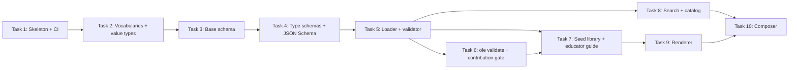

# MVP implementation tasks

These are the first ten implementation steps for Open Lesson Engine, written so each can be copied directly into a GitHub issue. They build on each other in order, and they deliver the MVP defined in [DEVELOPMENT.md §12](../../DEVELOPMENT.md#12-the-mvp).

**Suggested labels:** `mvp`, `area:model`, `area:library`, `area:cli`, `area:content`, `area:docs`, `good first issue`, `educators welcome`.

---

## Task 1: Set up the TypeScript project skeleton and CI

**Labels:** `mvp`, `area:tooling` · **Depends on:** nothing

### Why

Contributors need a working, consistent development environment before any engine code is written.

### Scope

- `package.json`: name `open-lesson-engine`, `"type": "module"`, `engines.node >= 22`, and scripts `build`, `test`, `lint`, `format`, `typecheck`.
- `tsconfig.json` with `strict: true`.
- Vitest configuration and one smoke test.
- Biome configuration for linting and formatting.
- `src/index.ts` as the public entry point (empty exports are fine).
- `.editorconfig`, `.nvmrc` (Node 22), and `.gitignore` (`node_modules/`, `dist/`, `drafts/`).
- A GitHub Actions workflow on pull requests and on pushes to `main` that runs install, lint, typecheck, and test on Node 22 and 24.
- Update the README "For Developers" section and [DEVELOPMENT.md §17](../../DEVELOPMENT.md#17-development-workflow) with the real commands.

### Acceptance criteria

- [ ] In a fresh clone, `npm ci && npm test && npm run lint && npm run typecheck` all pass.
- [ ] CI runs on pull requests and passes.
- [ ] No runtime dependencies are added yet; only dev dependencies.
- [ ] The docs list the exact setup commands.

### Out of scope

Schemas, the CLI, and content.

---

## Task 2: Define controlled vocabularies and shared value types

**Labels:** `mvp`, `area:model`, `educators welcome` · **Depends on:** Task 1

### Why

Search and composition only work if metadata is consistent. Vocabularies must be **data**, so educators can extend them without code changes ([DEVELOPMENT.md §5.4–5.5](../../DEVELOPMENT.md#54-shared-value-types)).

### Scope

- Vocabulary files in `vocabularies/`: `subjects.yaml` (hierarchical, with `parent`), `grade-levels.yaml` (ordered), `activity-types.yaml`, `instructional-formats.yaml`, `learner-needs.yaml`, and `standards-frameworks.yaml` (with an optional `code_pattern` regex per framework).
- A typed vocabulary loader that validates the vocabulary files themselves: unique IDs, `snake_case` IDs, and parents that exist.
- Value types and parsers in `src/model/`:
  - **GradeRange:** parses `7`, `"6-8"`, `"K-2"`, `"9-12"`, and `"12-transition"` into `{ min, max }`, and provides an `overlaps()` helper.
  - **StandardRef:** parses `"NGSS:MS-LS1-6"` into `{ framework, code }`.
  - Also `Difficulty`, `License`, `ContributorRole`, and `Contributor` as closed enumerations and objects.
- "Did you mean…?" suggestions for unknown vocabulary terms, using edit distance.

### Acceptance criteria

- [ ] Every vocabulary file loads, validates, and has a `description` on every term.
- [ ] Learner-need terms are functional needs, not diagnoses or disability labels ([ADR 0004](../decisions/0004-no-student-data.md)).
- [ ] The grade parser handles single grades, ranges, `K`, `PK`, `transition`, and `adult`, and rejects reversed ranges such as `8-6`.
- [ ] Standards references with an unknown framework are rejected. A code that doesn't match the framework's `code_pattern` is rejected.
- [ ] Unit tests cover the valid and invalid cases for each parser.

### Educators can help by

Reviewing the starter vocabulary lists for missing or confusing terms, especially subjects, activity types, and learner needs.

---

## Task 3: Implement the base component schema

**Labels:** `mvp`, `area:model` · **Depends on:** Task 2

### Why

Every component type shares a common foundation of identity, classification, and provenance ([DEVELOPMENT.md §5.3](../../DEVELOPMENT.md#53-the-common-foundation-all-components)).

### Scope

- A Zod schema for the base fields.
  - Required: `id`, `type`, `version`, `title`, `summary`, `license`, `contributors`, `status`.
  - Optional: `description`, `subjects`, `topics`, `grades`, `duration_minutes`, `difficulty`, `standards`, `objectives`, `prerequisites`, `prior_knowledge`, `tags`, `language`, `derived_from`, `adaptation`, `sources`, `ai_assisted`, `created`, `updated`, `schema_version`.
- ID rules: kebab-case, 3–80 characters.
- `version` must be semver.
- `adaptation` block: `kind` (`accommodation` | `modification` | `extension`), `learner_needs`, `strategies`, `notes`. It is only allowed when `derived_from` is present.
- A discriminated union on `type` that the next task extends.
- Exported TypeScript types inferred from the schemas, with TSDoc on each field that explains its educational meaning.

### Acceptance criteria

- [ ] A minimal valid component (only the required fields) passes.
- [ ] Clear error messages for: missing required fields, a bad ID, a bad semver, an unknown license, `adaptation` without `derived_from`, and a contributor with an email-like `name`.
- [ ] Unknown fields are rejected, so a typo like `grade:` for `grades:` is caught.
- [ ] Tests cover each rule.

---

## Task 4: Implement the component type schemas and JSON Schema export

**Labels:** `mvp`, `area:model` · **Depends on:** Task 3

### Why

Each component type has its own structure on top of the common foundation ([DEVELOPMENT.md §5.6](../../DEVELOPMENT.md#56-type-specific-fields-summary)).

### Scope

- Schemas for all eight types: `objective`, `activity`, `worksheet`, `assessment`, `differentiation_strategy`, `instructional_strategy`, `template`, and `lesson_plan`.
- Shared sub-schemas:
  - `Item` (question kinds, choices, answer, points, hint, objective)
  - `Rubric` (criteria and levels)
  - `Checklist` (skills checks)
  - `Material`, `Step`
  - `Slot` (template slots with `accepts`, `activity_types`, `minutes`, `required`)
  - `Segment` (lesson sequence entries with `slot`, `use`, `minutes`, `notes`)
- Type-specific rules. For example: an assessment must have `items`, `rubric`, or `checklist`; a multiple-choice item must include its answer among its choices; a lesson segment must have `use` or `notes`.
- `npm run schemas` generates `schemas/<type>.schema.json` from the Zod schemas, and CI fails if the generated files are out of date.
- `.vscode/settings.json` maps each `library/<folder>/*.yaml` glob to its schema, for autocomplete in editors.

### Acceptance criteria

- [ ] Each type has at least one valid fixture and several invalid fixtures, with tests that assert the error messages.
- [ ] The DEVELOPMENT.md examples (§6.2, §7.1, §7.2, §8.1) validate against the schemas. The examples and the schemas must agree.
- [ ] Generated JSON Schemas include field descriptions, so editors show help text.
- [ ] [DEVELOPMENT.md §5](../../DEVELOPMENT.md#5-domain-model) is updated with the final field lists.

---

## Task 5: Build the library loader and validator

**Labels:** `mvp`, `area:library` · **Depends on:** Task 4

### Why

Validation is what makes community contributions safe to accept. Its errors must be understandable by teachers ([DEVELOPMENT.md §9](../../DEVELOPMENT.md#9-validation)).

### Scope

- `loadLibrary(rootDir)`: reads every `library/**/*.yaml` file and all vocabularies, parses them with line numbers, and returns a `Library` object with typed, indexed components plus diagnostics.
- The four validation layers:
  1. **Structure:** schemas.
  2. **Vocabulary:** terms exist, with suggestions for near-misses.
  3. **Library (cross-file):**
     - IDs are unique, and the path matches `type` and `id`.
     - References resolve to the right types.
     - There are no cycles in `prerequisites` or `derived_from`.
     - Variants keep the original contributors and a compatible license.
     - Lesson segment minutes add up to `duration_minutes` (warning).
     - Template slot references are valid.
  4. **Privacy lint** (warnings): email addresses, phone numbers, and phrases like "student name".
- A diagnostic format with severity, file, line, message, and a fix hint. The engine returns diagnostics as data; formatting them for display is the CLI's job.

### Acceptance criteria

- [ ] Fixture libraries in `tests/fixtures/` cover a valid library and at least one broken case per rule.
- [ ] Every diagnostic includes the file path and, where possible, the line number.
- [ ] Error messages are reviewed for plain language; no stack traces or schema jargon.
- [ ] The core has no filesystem access outside the loader module.

---

## Task 6: Add `ole validate` and the contribution gate

**Labels:** `mvp`, `area:cli`, `area:docs` · **Depends on:** Task 5

### Why

Contributors need immediate, automatic feedback on their pull requests, and teachers without git experience need guided ways to contribute.

### Scope

- An `ole` command (the `bin` entry in `package.json`) built with `node:util` `parseArgs`.
- `ole validate [paths…]`: prints diagnostics grouped by file, and exits non-zero on errors.
- A CI job that runs `ole validate` on every pull request touching `library/` or `vocabularies/`.
- A `.github/pull_request_template.md` with a content checklist: privacy, rights and license, fictional data, timing, and safety.
- GitHub issue forms (`.github/ISSUE_TEMPLATE/`):
  - "Share a resource or idea", which asks for subject, grades, time, materials, steps, and objectives
  - "Classroom test report", with an explicit "no student data" reminder
  - "Bug report"
  - "Propose a vocabulary term"
- Update CONTRIBUTING.md with the real commands and links to the forms.

### Acceptance criteria

- [ ] `npx ole validate` works in a fresh clone.
- [ ] A pull request with an invalid component shows a failing check with readable messages.
- [ ] Issue forms render on GitHub, and the privacy reminder appears on every form.

---

## Task 7: Create the seed component library and educator guide

**Labels:** `mvp`, `area:content`, `educators welcome` · **Depends on:** Tasks 5 and 6

### Why

Examples teach the format better than documentation does. A useful seed library also makes composition possible, and it shows other teachers what good components look like.

### Scope

- At least 20 components using **fictional content**, across at least three subjects. For example: earth and space science, biology, environmental science, and horticulture (CTE).
- Every component type represented, including at least two templates: a 5E lesson and a work-based skills lesson.
- At least one complete `lesson_plan` whose referenced components all exist (for example, the photosynthesis leaf-disk lesson from DEVELOPMENT.md).
- At least two adapted variants using `derived_from`: one `accommodation` and one `modification`.
- Differentiation strategies covering at least five learner-need categories.
- `docs/guides/writing-your-first-component.md`: a step-by-step walkthrough for teachers that uses a seed file as the example and includes editing through GitHub's web interface.

### Acceptance criteria

- [ ] `ole validate` passes on the whole library with zero errors and zero privacy warnings.
- [ ] Every component with hands-on steps includes safety notes.
- [ ] At least one educator who isn't the author has reviewed the seed content.
- [ ] The guide has been tried by someone who hasn't used GitHub before, and their feedback has been incorporated.

### Educators can help by

Writing and reviewing seed components. This task is ideal for teachers.

---

## Task 8: Search and catalog

**Labels:** `mvp`, `area:library`, `area:cli` · **Depends on:** Task 5

### Why

Teachers need to find components by the things they think about: subject, grade, topic, time, standard, and supports.

### Scope

- A pure `search(library, filters)` function in the engine. Filters:
  - `type`
  - `subject` (includes descendant subjects)
  - `grades` (overlap)
  - `topic`
  - `standard`
  - `activity_type`
  - `learner_needs`
  - `status`
  - `max_minutes`
  - free text over the title and summary
- `ole find` with flags for each filter, printing a readable table.
- `ole catalog`, which generates:
  - `library/CATALOG.md`, browsable on GitHub, grouped by subject and then type, with links to files
  - `catalog.json`, a machine-readable index for the future website
- A CI check that `CATALOG.md` is up to date, or CI regenerates it.

### Acceptance criteria

- [ ] Results are deterministic and sorted predictably.
- [ ] Searching `--subject science` finds `biology` components through the subject hierarchy.
- [ ] Searching `--grades 7` finds components for `6-8`.
- [ ] Tests cover each filter, including combined filters.

---

## Task 9: Render lessons and components to printable documents

**Labels:** `mvp`, `area:render` · **Depends on:** Tasks 5 and 7

### Why

The engine is only useful in a classroom if it produces materials a teacher can print and use.

### Scope

- `ole render <id> [--format md|html] [--out dir]`.
- For a lesson plan, produce:
  - a **teacher copy**: objectives and success criteria; a timing table; **materials gathered from every referenced component**; each segment's full instructions; safety notes; differentiation notes; and **automatically discovered variants**
  - **student handouts**: worksheets and assessments with answers removed
  - **answer keys**, as a separate document
  - an **attribution block**: every component, its contributors and license, and the combined license of the lesson ([ADR 0003](../decisions/0003-licensing.md))
- Rendering single components (an activity, a worksheet) also works.
- HTML output includes print CSS: page breaks between documents, and a readable font size.
- Stretch goal: a `--large-print` option.

### Acceptance criteria

- [ ] Snapshot tests cover the rendered output of the seed lesson.
- [ ] Student handouts never contain answers (tested explicitly).
- [ ] HTML output passes an automated accessibility check (for example axe-core): headings in order, lists marked up as lists.
- [ ] Markdown inside fields is rendered safely; raw HTML is escaped or sanitized.

---

## Task 10: Rule-based lesson composer

**Labels:** `mvp`, `area:compose` · **Depends on:** Tasks 8 and 9

### Why

This is the heart of the project: assembling complete lessons from reusable components, deterministically and explainably, with no AI ([DEVELOPMENT.md §7.4](../../DEVELOPMENT.md#74-the-rule-based-composer), [ADR 0005](../decisions/0005-deterministic-composition-ai-optional.md)).

### Scope

- A pure `compose(library, request)` function. The request contains:
  - `template`, `grades`, and `duration_minutes`
  - optionally `topics`, `standards`, `supports` (learner needs), and `include` / `exclude` IDs
- The algorithm from DEVELOPMENT.md §7.4:
  1. Find candidate objectives.
  2. Filter each slot.
  3. Score candidates, breaking ties by ID.
  4. Fit the time, reporting any overage and never silently dropping a required slot.
  5. Attach matching differentiation strategies.
- Output:
  - a draft `lesson_plan` YAML file with `status: draft`, written to `drafts/` by default and not into `library/`
  - a **composition report** listing each slot's choice, reasons, alternatives, **gaps**, and the time total
- `ole compose --template … --grades … --minutes … [--topic …] [--standard …] [--supports …]`.

### Acceptance criteria

- [ ] The same library and request always produce byte-identical output (tested).
- [ ] Every chosen component has at least one stated reason, and every unfilled required slot is reported as a gap.
- [ ] The composed draft passes `ole validate` when moved into `library/`.
- [ ] Composition makes no network calls and has no AI dependencies (tested or enforced by lint).

---

## After the MVP

These are candidates for the next round, in rough priority order. Each needs its own issue, and most need an ADR.

1. **Static website (GitHub Pages)** for browsing, rendering, and composing in the browser, with no server.
2. **Images and visual supports**, with required alt text and license metadata.
3. **Deterministic transforms and render options:** reduced answer choices, step cards, large print, one question per page.
4. **Units**: a component type that composes lessons.
5. **AI adapter interface** (optional, off by default): proposes draft components for gaps. Output is reviewed like any contribution.
6. **Standards packs:** optional, properly licensed standards descriptions per framework.
